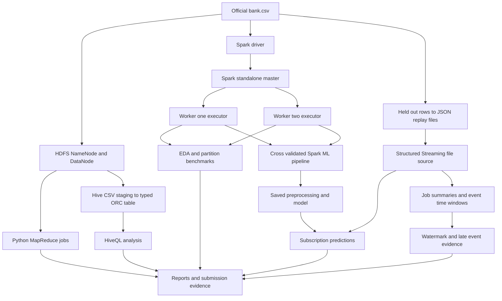

# Architecture and build sequence

The banking CSV feeds two independent demonstrations. Hadoop stores the original CSV in HDFS and runs Python MapReduce through Hadoop Streaming. Hive queries a typed ORC table derived from the same HDFS source. Spark uses a standalone master, two worker containers and a driver for EDA, model training, streaming replay and partition experiments.

1. Read the five official question sets and inspect the supplied dataset.
2. Keep the original data intact and record its SHA256 checksum.
3. Configure HDFS and Hive; ingest the CSV and create the typed table.
4. Implement and verify Hadoop MapReduce jobs and Hive queries.
5. Start Spark master, two workers and a driver; confirm both workers register.
6. Run Spark EDA, check nulls and duplicates, and record counts and rates.
7. Make a stable train/test split before fitting any preprocessing.
8. Cross-validate candidate models on training data; select by PR-AUC.
9. Evaluate the selected model on held-out data and save the full pipeline.
10. Replay held-out records with synthetic timestamps through streaming queries.
11. Verify per-event predictions, updated aggregates and late-row drops.
12. Benchmark partition counts, check equal results and record driver/container resources.
13. Assemble question-by-question outputs and document the limits.
14. Rehearse and record a video of at least 15 minutes; upload the final recording and submit the links.

## What this local architecture demonstrates

HDFS uses one NameNode and one DataNode, replication factor 1. Hadoop MapReduce uses LocalJobRunner over HDFS, not YARN; Hive executes genuine HiveQL using the local MR engine. Spark uses separate networked worker processes on one laptop. This demonstrates distributed task execution but not a multi-machine high-availability deployment. The services run in stages to fit Docker's approximately 4 GB memory allocation.

The saved model is produced before streaming. A prediction request does not retrain it. Synthetic replay data demonstrates event-time semantics; it does not establish actual real-time banking or fraud patterns.
